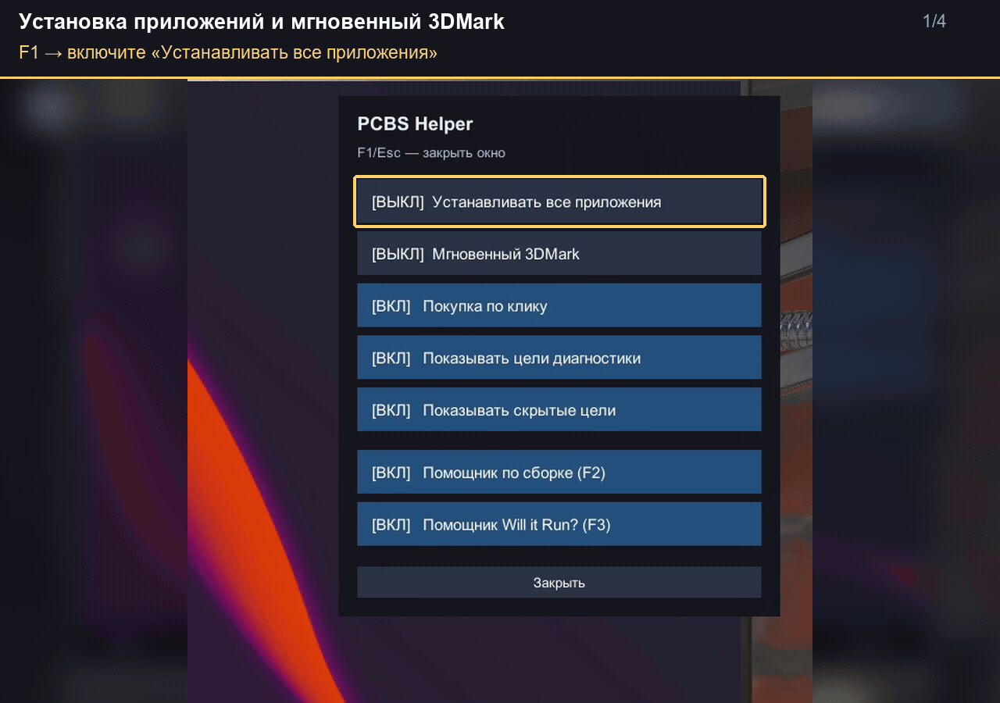
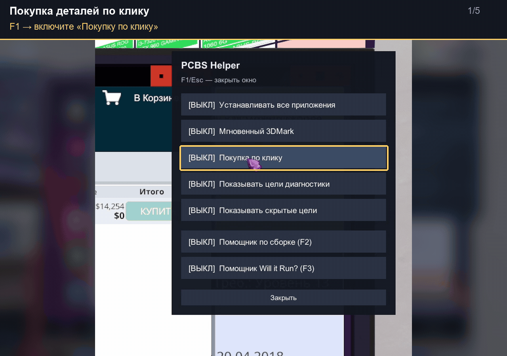
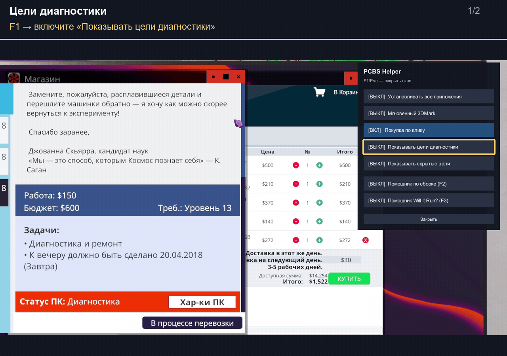
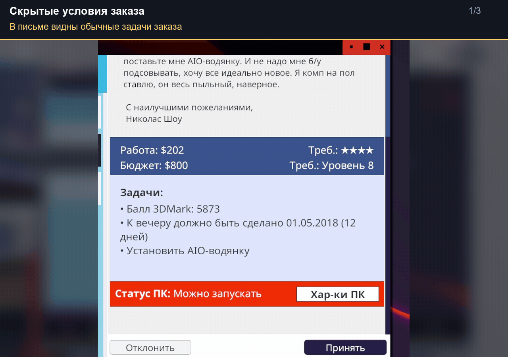
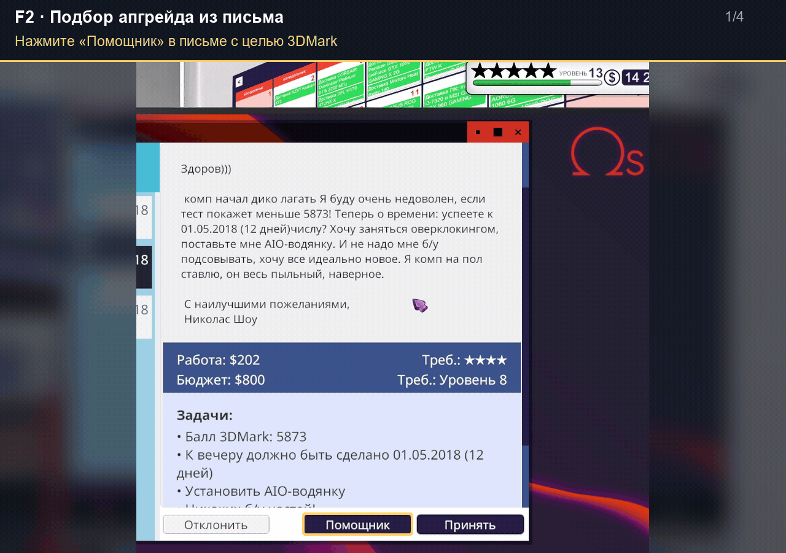
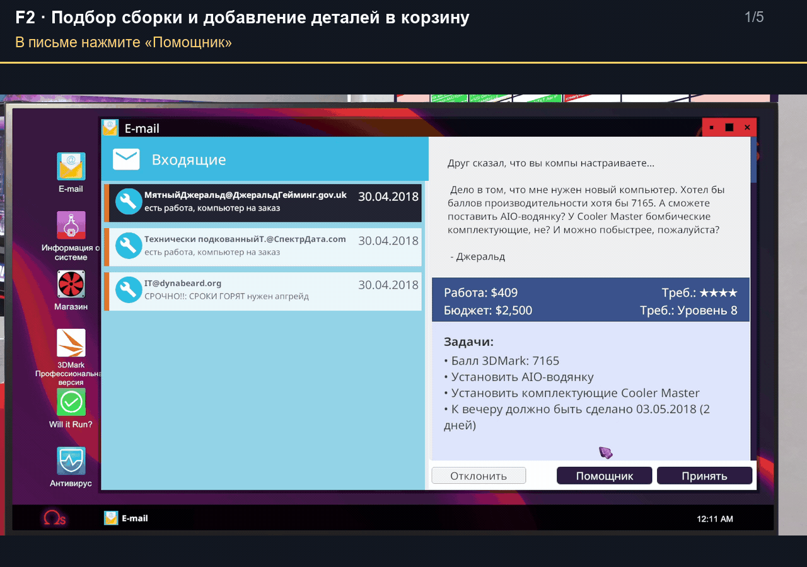
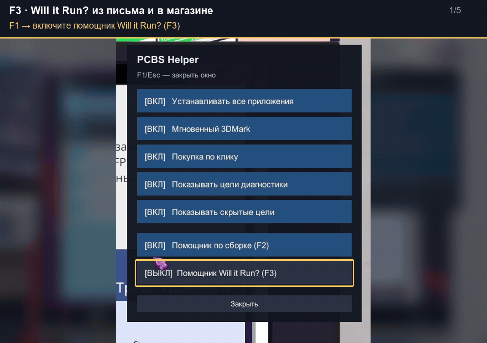
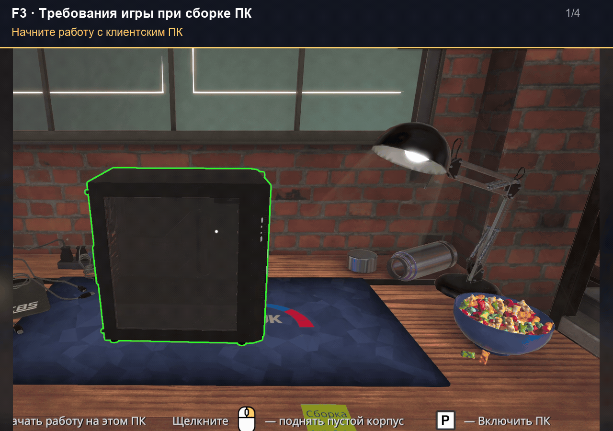

# PCBS-Helper

**Русский** | [English](README_EN.md)

**Помощник для PC Building Simulator 1 на Windows. Версия 1.0.1.**
Проверено на версии игры **1.15.3**. Для PC Building Simulator 2 не подходит.

Работает прямо в игре: настройки удобства, «Помощник по сборке» и
«Помощник Will it Run?». Интерфейс на русском и английском, язык берётся из игры.
Помощники встроены в DLL — отдельную программу запускать не нужно.

В этом README — установка и **пошаговый гайд с 9 GIF-демонстрациями**:
[функции F1](#f1) · [помощник по сборке F2](#f2) · [Will it Run? F3](#f3).

## Скачать и установить

В [релизе](https://github.com/Kalarono/PCBS-Helper/releases) доступны два способа установки.

### Полный архив — самый простой способ

1. **Закройте игру** и скачайте **PCBS-Helper-1.0.1-Full.zip**.
   Внутри уже есть BepInEx 5 x64 и хелпер.
2. В Steam нажмите правой кнопкой на PC Building Simulator →
   **Управление → Просмотреть локальные файлы**.
   В папке должны быть `PCBS.exe` и `PCBS_Data`.
3. **Распакуйте содержимое ZIP прямо в эту папку**, без дополнительной
   вложенной папки. `winhttp.dll`, `doorstop_config.ini` и папка `BepInEx`
   должны оказаться рядом с `PCBS.exe`.
4. **Запустите игру, загрузите сохранение и зайдите в мастерскую.**
   Нажмите **F1**, **F2** или **F3**, чтобы открыть нужную панель.

### Отдельная DLL — если BepInEx уже работает

Закройте игру, скачайте **PCBS-Helper.dll** и положите её сюда:

```text
PC Building Simulator/BepInEx/plugins/PCBS-Helper/PCBS-Helper.dll
```

Создайте папки `plugins/PCBS-Helper`, если их нет.
Нужен **BepInEx 5 для Windows x64**.

Для установки по частям к релизу также приложены
**BepInEx_win_x64_5.4.23.5.zip**, **README.txt** с инструкцией на русском
и **README_EN.txt** с инструкцией на английском.
Архивы **Source code** для установки не нужны.

## Управление

| Клавиша | Действие |
| --- | --- |
| **F1** | Настройки: установка приложений, быстрый 3DMark, показ целей и включение помощников F2/F3. |
| **F2** | Помощник по сборке: оценка 3DMark, подбор сборки, апгрейда и замены деталей. |
| **F3** | Помощник Will it Run?; закрепляет панель, повторное нажатие скрывает её. |
| **Alt** | Включает или выключает курсор для работы с F2/F3. |
| **Esc** | Закрывает F1 или скрывает F2. |

Окна можно двигать за заголовок. Настройки, позиции и данные помощника по сборке
сохраняются между запусками.

## Гайд по функциям

После установки загрузите сохранение и зайдите в мастерскую.
Названия кнопок ниже приведены для русского интерфейса игры.
В **F1** включите нужные функции: **«ВКЛ»** означает, что функция активна.
Закрытие окна F1 сохраняет выбранные настройки.

<a id="f1"></a>

### F1 — настройки удобства

Новые функции сборки: **автоматическая термопаста**, **снятие зависимостей
при удержании ЛКМ** и **замена всех доступных цветных кабелей**. Включаются
отдельно в F1. В режиме снятия удерживайте ЛКМ на заблокированной детали:
кабели и мешающие детали снимаются по очереди с обычными анимациями.
Отпускание ЛКМ ставит процесс на паузу; Esc отменяет очередь.
В режиме кабелей (3) выберите активный кабель — все подключённые соединения,
которым игра разрешает менять оформление, примут выбранный цвет.

Термопаста наносится при установке CPU в сокет и повторно при установке
охлаждения, если паста отсутствует. Поддерживается и СЖО со слотом в корпусе.

В заголовке инвентаря появились кнопки **сортировки по цене и поступлению**.
Повторный щелчок меняет направление; выбор запоминается. По умолчанию
новые поступления первыми. Цена соответствует карточке продажи, а поступление
определяется сохранённым порядком добавления в инвентарь.
Подробнее: [помощники монтажа и сортировка](docs/USAGE.md#помощники-монтажа-и-кабелей).

#### 1. Установка всех приложений и мгновенный 3DMark

1. Нажмите **F1** и включите **«Устанавливать все приложения»**.
2. На рабочем столе игрового ПК откройте **«Установка и удаление программ»** —
   приложения появятся на рабочем столе этого ПК.
3. В F1 включите **«Мгновенный 3DMark»**.
4. Откройте 3DMark на игровом ПК и нажмите **«Запустить»** — результат
   появится без ожидания теста.

Балл по-прежнему зависит от комплектующих ПК. Для предварительной оценки
другой конфигурации используйте вкладку **«Балл 3DMark»** в F2.



#### 2. Покупка деталей по клику

1. В **F1** включите **«Покупка по клику»**.
2. Откройте письмо с клиентским ПК и нажмите **«Хар-ки ПК»**.
3. Нажмите **ЛКМ** по нужной детали в списке — одна новая деталь той же
   модели добавится в корзину магазина. Повторный щелчок добавляет ещё одну.
4. Откройте магазин, проверьте корзину, выберите доставку и оформите покупку.

Открывать магазин перед добавлением не требуется. Деньги списываются при
оформлении покупки. Недоступные в магазине детали не добавляются;
сообщение после щелчка показывает результат.



#### 3. Цели диагностики

1. Откройте письмо с заданием **«Диагностика и ремонт»**.
2. В **F1** включите **«Показывать цели диагностики»**.
3. Посмотрите список задач в письме — в нём сразу будут видны детали,
   которые нужно заменить.

В демонстрации раскрываются цели **«Надо заменить: ЦП»** и **«Надо заменить: БП»**.



#### 4. Скрытые условия заказа

1. Откройте письмо с заказом.
2. В **F1** включите **«Показывать скрытые цели»**.
3. Проверьте дополнительные пункты в списке задач и учтите их при сборке
   или ремонте.

В демонстрации появляются условия **«Никаких б/у частей!»** и **«Пропылесосить»**.



<a id="f2"></a>

### F2 — Помощник по сборке

В **F1** включите **«Помощник по сборке (F2)»**. Нажмите **F2**, затем
**Alt**, чтобы включить курсор для полей и кнопок. Можно открыть помощник
кнопкой **«Помощник»** в письме с целью 3DMark.

#### 5. Оценка 3DMark без запуска ПК

Калькулятор использует данные из установленной PCBS. Поля частот CPU, GPU и
памяти GPU можно оставить пустыми для заводских значений или заполнить по BIOS.
Расчёт предполагает стабильную работу без перегрева. При первом открытии
совместимость деталей подготавливается в фоне; расчёт 3DMark доступен сразу.
GIF ниже записан с прежним оформлением калькулятора.

1. Откройте вкладку **«Балл 3DMark»**.
2. Выберите процессор **CPU**, видеокарту **GPU** и количество видеокарт.
3. Укажите частоту и каналы ОЗУ, затем нажмите **«Рассчитать»**.
4. Посмотрите расчётный балл. Меняйте детали в полях, чтобы сравнивать
   разные сочетания без их покупки и установки.

Для оценки текущего ПК вручную сверяйте выбранные модели с установленными
деталями. Это предварительный расчёт; результат задания проверяется
тестом 3DMark в игре. В примере помощник рассчитывает **4263 балла**.


#### 6. Подбор апгрейда из письма

1. В письме с заданием на повышение результата 3DMark нажмите **«Помощник»**.
2. Откроется **«Подбор апгрейда»**: бюджет, цель и доступные характеристики
   клиентского ПК перенесутся автоматически.
3. Проверьте блок **«Условия задания и ограничения расчёта»**, резерв бюджета
   и параметры подбора.
4. Нажмите **«Подобрать апгрейды»** и сравните варианты по деталям, цене,
   остатку бюджета и расчётному баллу.
5. Купите нужные детали в магазине и установите их в клиентский ПК.

Кнопка **«Помощник»** переносит данные; заказ нужно принять отдельно,
а подбор запустить кнопкой во вкладке.



#### 7. Подбор новой сборки и заказ деталей

1. В письме с заданием на новый ПК и целью 3DMark нажмите **«Помощник»**.
2. В **«Подбор сборки»** перенесутся бюджет и требуемый балл.
   Проверьте условия задания и **«Резерв бюджета»** — для новой сборки
   он сначала равен **$400**. Измените его под БП, охлаждение и накопители.
3. Нажмите **«Подобрать сборки»** и выберите подходящий вариант.
4. В конце его строки нажмите **«Заказать»**. При необходимости прокрутите
   таблицу вправо. После добавления кнопка покажет **«В корзине»**.
5. Откройте магазин, проверьте корзину и добавьте остальные детали.
   Выберите доставку и оформите покупку обычным способом.

**«Заказать»** добавляет корпус, CPU, материнскую плату, ОЗУ и GPU,
включённые в выбранный результат, с нужным количеством модулей памяти
и видеокарт. **Блок питания, накопители и охлаждение подбирайте отдельно.**
Эта кнопка работает независимо от **«Покупки по клику»** в F1.

Если появилась надпись **«Частично в корзине»**, прочитайте список
пропущенных деталей под формой и закажите их вручную.



#### Другие возможности F2

| Вкладка или действие | Как пользоваться |
| --- | --- |
| **Замена деталей** | Укажите исходный ПК и ограничения, затем нажмите **«Подобрать детали»**, чтобы получить варианты замены. |
| **История и сохранения** | Просматривайте историю расчётов и сохранённые варианты. |
| **Развернуть / Свернуть** | Переключайте большое окно и компактную панель. |
| **− / +** | Меняйте размер текста и элементов. |
| **Очистить** | Сбрасывайте поля и результаты текущей расчётной вкладки. |

Уровень карьеры и процент опыта заполняются из игры автоматически.
В обычной карьере оставьте **All Parts Unlocked?** выключенным,
чтобы подбор учитывал доступность деталей. Бюджет означает деньги на
комплектующие; оплату работы к нему не прибавляйте.
Условия по ремонту, накопителям, охлаждению и разгону проверяйте отдельно.
Описание всех полей и ограничений — в [подробном руководстве](docs/USAGE.md).

<a id="f3"></a>

### F3 — Помощник Will it Run?

В **F1** включите **«Помощник Will it Run? (F3)»**. Панель показывает
требования игры из заказа **«Можно поиграть в …»**: профиль требований
(минимальные, рекомендуемые или 4K), ОЗУ, видеопамять, GPU, CPU и место на диске.

#### 8. Требования из письма и подбор деталей в магазине

1. В письме с заказом **«Можно поиграть в …»** нажмите **«Will it Run?»**.
2. Посмотрите требования заказа. Если заказ их уточняет, ниже появляется
   **«Уточнения заказа»**: нужный бренд CPU/GPU, память, накопитель и другие
   условия. При необходимости замены CPU/GPU показывается подходящая доступная деталь.
3. Откройте магазин и выбирайте детали, сверяясь с панелью — после открытия
   кнопкой из письма она уже закреплена.
4. Нажмите **F3**, чтобы скрыть закреплённую панель.

Проверьте совместимость сокета выбранного CPU и материнской платы.
Без дополнительных условий блок уточнений не показывается. При ручном
выборе игры условия прежнего заказа к ней не добавляются.
Кнопка **«Will it Run?»** открывает требования без принятия заказа.



#### 9. Требования во время сборки клиентского ПК

1. Начните работу с клиентским ПК, у которого есть задание **«Можно поиграть»**.
2. Панель требований появится автоматически — сверяйтесь с ней при установке
   комплектующих.
3. Для перемещения панели нажмите **Alt** и перетащите её за заголовок
   в удобное место.
4. Чтобы сохранить панель на экране при переходе в магазин, нажмите **F3**.
   Повторное нажатие скроет её.



Для ручного поиска нажмите **Alt → «Выбрать игру»**. Кнопка **«Из задания»**
возвращает требования текущего заказа. Повторное **Alt** выключает курсор.

## Обновление и удаление

**Обновление:** закройте игру и замените только `PCBS-Helper.dll` в той же папке.
Настройки сохранятся, работающий BepInEx переустанавливать не нужно.

**Удаление:** при закрытой игре перенесите папку `BepInEx/plugins/PCBS-Helper`
за пределы `plugins`.

## Если не работает

- На некоторых клавиатурах используйте **Fn + F1/F2/F3**.
- Если F1 работает, а F2/F3 нет, включите соответствующий помощник в F1.
- Для нажатия кнопок F2/F3 включите курсор клавишей **Alt**.
- Если ничего не открывается, проверьте путь к DLL и наличие
  `BepInEx/LogOutput.log`. Для сообщения об ошибке приложите этот лог,
  версии игры и мода, а также описание проблемы.

## Подробнее

- [Руководство: панели, поля помощника по сборке и перенос заданий](https://github.com/Kalarono/PCBS-Helper/blob/main/docs/USAGE.md).
- [Решение проблем и настройка клавиш](https://github.com/Kalarono/PCBS-Helper/blob/main/docs/TROUBLESHOOTING.md).
- [История версий](CHANGELOG.md) · [Сборка из исходников](DEVELOPMENT.md).

Калькулятор написан для PCBS-Helper. Данные деталей и коэффициенты 3DMark читаются из установленной игры; сторонний HTML-калькулятор в DLL не включён.
Автор PCBS-Helper и его калькулятора: **Kalarono**.
BepInEx: [официальный проект](https://github.com/BepInEx/BepInEx), лицензия MIT.
Полный архив содержит `BepInEx-LICENSE.txt`. Иллюстрация обложки создана с помощью ИИ.
