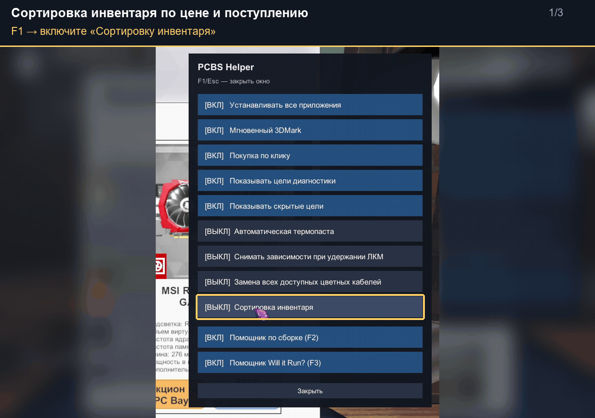
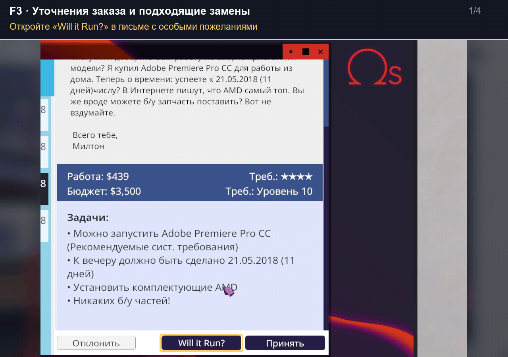
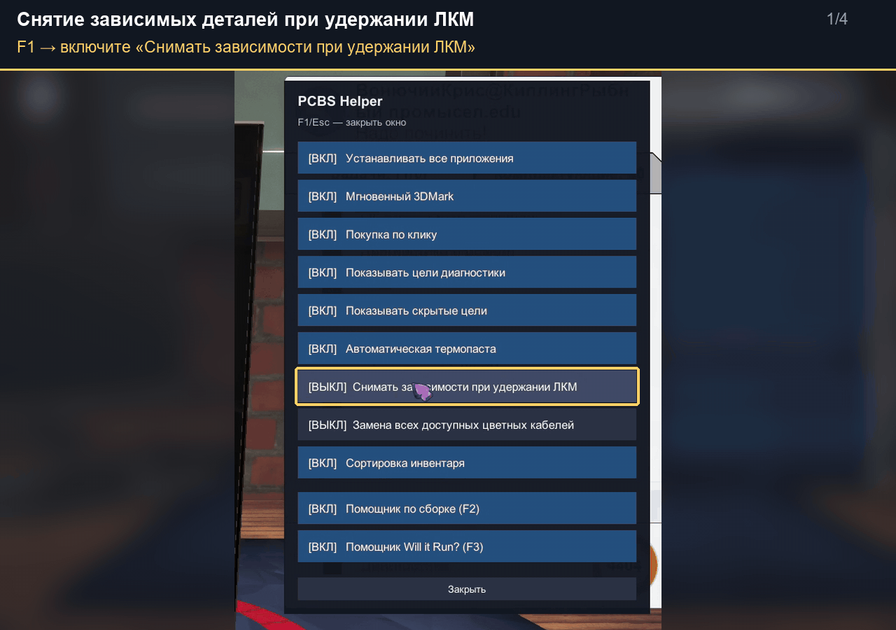
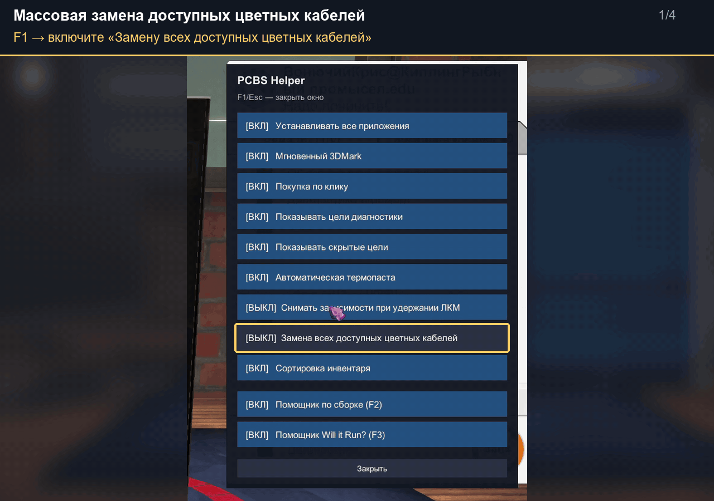

# PCBS-Helper

[Русский](README.md) | **English**

**An in-game helper for PC Building Simulator 1 on Windows. Version 1.0.1.**
Tested with game version **1.15.3**. Not compatible with PC Building Simulator 2.

Convenience settings, a **Build Helper** and a **Will it Run? Helper**, all
available inside the game. The interface follows the game's language:
Russian or English, with English used for other languages.
Both helpers are embedded in the DLL; no separate application is needed.

This README includes installation instructions and a **step-by-step guide
with 13 GIF demonstrations**:
[F1 settings](#f1) · [F2 Build Helper](#f2) · [F3 Will it Run?](#f3) ·
[new features in 1.0.1](#v101).

## Download and install

Choose one of the two installation methods on the
[Releases page](https://github.com/Kalarono/PCBS-Helper/releases).

### Full archive — the easiest option

1. **Close the game** and download **PCBS-Helper-1.0.1-Full.zip**.
   The archive includes BepInEx 5 x64 and the helper.
2. In your Steam library, right-click PC Building Simulator →
   **Manage → Browse local files**.
   This folder should contain `PCBS.exe` and `PCBS_Data`.
3. **Extract the contents of the ZIP directly into this folder**, without
   creating an extra folder. `winhttp.dll`, `doorstop_config.ini` and
   the `BepInEx` folder should be next to `PCBS.exe`.
4. **Launch the game, load a save and enter the workshop.**
   Press **F1**, **F2** or **F3** to open a panel.

### DLL only — if BepInEx is already working

Close the game, download **PCBS-Helper.dll** and place it here:

```text
PC Building Simulator/BepInEx/plugins/PCBS-Helper/PCBS-Helper.dll
```

Create the `plugins/PCBS-Helper` folders if needed.
Requires **BepInEx 5 for Windows x64**.

For a separate installation, the release also includes
**BepInEx_win_x64_5.4.23.5.zip** and **README_EN.txt** with instructions
in English. **README.txt** contains the Russian instructions.
The **Source code** archives are not needed to install the helper.

## Controls

| Key | Action |
| --- | --- |
| **F1** | Settings: apps, instant 3DMark, job objectives, thermal paste, dependency removal, cable replacement, sorting and the F2/F3 helpers. |
| **F2** | Build Helper: estimate 3DMark scores, find builds, upgrades and replacement parts. |
| **F3** | Will it Run? Helper; opens/pins the panel, or hides it when already pinned. |
| **Alt** | Toggle the cursor to interact with F2/F3. |
| **Esc** | Close F1 or hide F2. |

Drag a window by its title bar to move it. Settings, window positions and
Build Helper data are saved between game sessions.

## Feature guide

After installation, load a save and enter the workshop.
The steps below use **English interface labels**. The GIFs were recorded
with the Russian interface, but show the same controls and actions.
In **F1**, enable the features you need: **ON** means a feature is active.
Closing the F1 window keeps your selected settings.

<a id="f1"></a>

### F1 — convenience settings

New workbench options: **Automatic thermal paste**, **Remove dependencies
while holding LMB**, and **Replace all customizable cables**. Enable each
option in F1. Hold LMB on a blocked part in removal mode to disconnect cables
and remove blocking parts in sequence, with normal animations and screw speed.
Release to pause; Esc cancels the queue. In cable mode (3), select the active
cable to replace existing connections whose appearance the game allows you to change.

Thermal paste is applied when installing a CPU and reapplied during cooler
installation if missing, including AIO coolers mounted in a case slot.

The inventory title bar now has **price and arrival-order sort buttons**.
Click the active button again to reverse direction; the selection is saved.
New arrivals appear first by default. Price matches the resale value on the
item card. Arrival order uses the game's saved insertion order, since the
game does not store calendar timestamps for inventory items.

#### 1. Install all apps and instant 3DMark

1. Press **F1** and enable **Install All Apps**.
2. On the in-game PC's desktop, open **Add/Remove Programs**.
   The applications will appear on that PC's desktop.
3. Enable **Instant 3DMark** in F1.
4. Open 3DMark on the in-game PC and start the test.
   The result appears without waiting for the benchmark.

The score still depends on the PC's hardware. To estimate a different
configuration before building it, use the **3DMark Score** tab in F2.


#### 2. Add parts to the cart with a click

1. Enable **Click Purchase** in **F1**.
2. Open a job email for a customer's PC and click **PC Stats**.
3. **Left-click** a part in the list to add one new part of the same model
   to the shop cart. Each additional click adds another unit.
4. Open the shop, check the cart, choose delivery and complete the purchase.

You do not need to open the shop before adding parts. Money is deducted
when you complete the purchase. Parts unavailable in the shop are skipped;
a message after each click shows the result.


#### 3. Reveal diagnosis objectives

1. Open an email for a diagnosis and repair job.
2. Enable **Show Diagnose Objectives** in **F1**.
3. Check the email's objective list: the parts that need replacement
   are now visible.

The demonstration reveals that the **CPU** and **PSU** need replacement.


#### 4. Reveal hidden job objectives

1. Open a job email.
2. Enable **Show Hidden Objectives** in **F1**.
3. Check the additional objectives and account for them when building
   or repairing the PC.

The demonstration reveals requirements to use **new parts** and
**clean the dust from the PC**.


<a id="f2"></a>

### F2 — Build Helper

Enable **Build Helper (F2)** in **F1**. Press **F2**, then **Alt** to show
the cursor and interact with fields and buttons. You can also open the
helper by clicking **Helper** in an email with a 3DMark target.

#### 5. Estimate 3DMark without turning on the PC

The calculator reads data from the installed PCBS. Leave the CPU, GPU and GPU
memory clock fields empty for stock frequencies, or enter the BIOS values.
Scores assume stable hardware without thermal throttling. Component compatibility
loads in the background on first use; 3DMark scoring is available immediately.
The GIF below shows the previous calculator design.

1. Open the **3DMark Score** tab.
2. Select the **CPU**, **GPU** and number of graphics cards.
3. Set **RAM Speed** and **RAM Channels**, then click **Calculate**.
4. Read the estimated score. Change the selected parts to compare
   configurations before buying or installing them.

To estimate the current PC's score, manually match the selected models
to its installed hardware. This is a preliminary calculation; use the
in-game 3DMark test to verify the job's result.
The example produces an estimated score of **4263**.


#### 6. Find an upgrade from a job email

1. In an email asking for a higher 3DMark score, click **Helper**.
2. The **Build Upgrader** tab opens with the budget, target score and
   available hardware details imported from the customer's PC.
3. Review **Job objectives and calculation limits**, the reserved budget
   and the search options.
4. Click **Get Upgrades** and compare the parts, price, remaining budget
   and estimated score of each option.
5. Buy the parts you need in the shop and install them in the customer's PC.

The **Helper** button imports data. Accept the job separately and start
the search using the button in the tab.


#### 7. Find a new build and order its parts

1. In an email requesting a new PC with a 3DMark target, click **Helper**.
2. The budget and target score are imported into **Build Maker**.
   Review the job objectives and **Reserved Budget**, which initially
   defaults to **$400** for new builds. Adjust it for the PSU, cooling
   and storage you plan to buy.
3. Click **Get Builds** and choose a suitable result.
4. Click **Order** at the end of its row. Scroll the table to the right
   if needed. Once the parts are added, the button shows **In cart**.
5. Open the shop, check the cart and add the remaining parts.
   Choose delivery and complete the purchase as usual.

**Order** adds the case, CPU, motherboard, RAM and GPU included in the
selected result, with the required numbers of RAM modules and graphics
cards. **Choose the PSU, storage and cooling separately.**
This button works independently of **Click Purchase** in F1.

If the button shows **Partly in cart**, read the list of skipped parts
below the form and order them manually.


#### Other F2 features

| Tab or action | How to use it |
| --- | --- |
| **Part Replacer** | Enter the original PC and your constraints, then click **Get Parts** to find replacements. |
| **History & Saves** | Review calculation history and saved results. |
| **Expand / Compact** | Switch between a large window and the compact panel. |
| **− / +** | Adjust the size of text and interface elements. |
| **Clear** | Reset the fields and results of the current calculation tab. |

Career level and experience percentage are filled in automatically from
the game. In a normal career, leave **All Parts Unlocked?** unchecked so
the search respects part availability. **Budget** is the amount available
for parts; do not add the payment for your work.
Review repair, storage, cooling and overclocking objectives separately.
All fields and constraints are described in the
[detailed guide (Russian)](docs/USAGE.md).

<a id="f3"></a>

### F3 — Will it Run? Helper

Enable **Will it Run? Helper (F3)** in **F1**. The panel displays the
requirements for a game's job objective: the profile (minimum, recommended
or 4K), RAM, VRAM, GPU, CPU and storage space.

#### 8. Open requirements from an email and shop for parts

1. In an email asking for a PC that can play a particular game,
   click **Will it Run?**.
2. Review the job's requirements. **Job clarifications** appears below when
   the order adds CPU/GPU brand, memory, drive or other constraints. When
   a different CPU/GPU is needed, it shows a suitable available replacement.
3. Open the shop and compare parts against the panel. Opening it from
   the email button already pins it.
4. Press **F3** to hide the pinned panel.

Check that your chosen CPU and motherboard have compatible sockets.
The clarification block is hidden when there are no additional conditions.
Manually choosing a game does not carry over the previous order's conditions.
The **Will it Run?** button opens the requirements without accepting the job.


#### 9. View requirements while building a customer's PC

1. Start working on a customer's PC with a job objective to play a game.
2. The requirements panel appears automatically. Use it as a reference
   while installing parts.
3. To move the panel, press **Alt** and drag it by its title bar.
4. Press **F3** to keep it on screen when switching to the shop.
   Press F3 again to hide it.


For manual lookup, press **Alt** and click **Choose game**.
**From job** returns to the current job's requirements.
Press **Alt** again to turn off the cursor.

<a id="v101"></a>

### New feature demonstrations in 1.0.1

Enable the three build helpers individually in **F1**; all three are disabled
by default. Inventory sorting is enabled by default. Automatic thermal paste
is described under [F1 settings](#f1); the other new features are shown below.

#### 10. Inventory sorting

1. In **F1**, check that **Inventory sorting** is enabled.
2. Open the inventory. The **Price** and **Arrival** buttons appear in its title bar.
3. Click **Arrival** to switch between newest-first and oldest-first order.
4. Click **Price** to switch between cheapest-first and most-expensive-first order.

Your selected order is saved. Price matches the resale value on the item card.
Arrival sorting uses the saved order in which items entered the inventory,
rather than calendar dates.



#### 11. Job clarifications and suitable replacements in F3

1. Enable **Will it Run? Helper (F3)** in **F1**.
2. Open an email with game requirements and additional customer requests.
3. Click **Will it Run?** and read the **Job clarifications** section.
4. Check the brand, model and other component requirements. When needed,
   the helper suggests a suitable CPU/GPU replacement based on performance,
   VRAM and career level.

The GIF shows two jobs requesting AMD and EVGA components.
A part that meets the job requirements must also be
compatible with the chosen PC's socket, case and power supply.



#### 12. Remove dependencies while holding LMB

1. Enable **Remove dependencies while holding LMB** in **F1**.
2. Press **2** to enter removal mode.
3. Point at a blocked component and hold the **left mouse button**.
   The helper disconnects cables, removes obstructing parts and then
   removes the selected component using the game's normal animations.
4. Release **LMB** to pause. Hold it again to resume.
   Press **Esc** to cancel the queue.

The example removes a motherboard after clearing its dependencies.
Drain full water-cooling loops manually first. The helper displays a message
if a dependency needs manual removal.



#### 13. Bulk replacement of colored cables

1. Enable **Replace all customizable cables** in **F1**.
2. Press **3** to enter cable mode and open the cable selection.
3. Select the cable color and style you want. Connected cables whose appearance
   the game allows you to change automatically switch to the selected style.
4. Check the result and the customer's job objectives.

The demonstration selects flexible red cables and completes the corresponding
job objective. Fixed cables on non-modular power supplies and cooling
components are skipped.



## Update and uninstall

**Update:** close the game and replace `PCBS-Helper.dll` in the same folder.
Your settings are preserved; a working BepInEx installation does not need
to be reinstalled.

**Uninstall:** with the game closed, move the
`BepInEx/plugins/PCBS-Helper` folder outside `plugins`.

## Troubleshooting

- Some keyboards require **Fn + F1/F2/F3**.
- If F1 works but F2/F3 do not, enable the corresponding helper in F1.
- To click buttons in F2/F3, toggle the cursor with **Alt**.
- If no panels open, check the DLL path and whether
  `BepInEx/LogOutput.log` exists. When reporting an issue, include this log,
  your game and helper versions, and a description of the problem.

## More information

The following additional documents are currently in Russian:

- [Detailed guide: panels, Build Helper fields and job import](docs/USAGE.md).
- [Troubleshooting and key bindings](docs/TROUBLESHOOTING.md).
- [Changelog](CHANGELOG.md) · [Building from source](DEVELOPMENT.md).

The calculator is implemented by PCBS-Helper. Component data and 3DMark coefficients are read from the installed game. No third-party HTML calculator is embedded in the DLL.
PCBS-Helper and its calculator by **Kalarono**.
BepInEx: [official project](https://github.com/BepInEx/BepInEx), MIT license.
The full archive includes `BepInEx-LICENSE.txt`.
