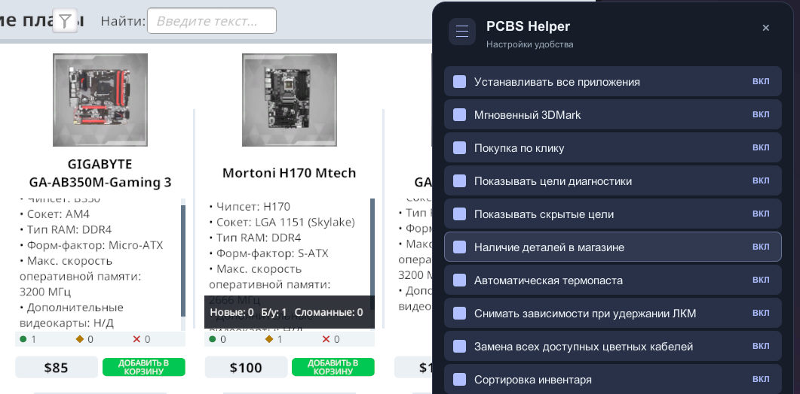

# Руководство PCBS-Helper

Установка: [README.md](../README.md).

## Управление: самое необходимое

| Клавиша или действие | Что делает |
| --- | --- |
| **F1** | Открыть или закрыть PCBS Helper. |
| **F2** | Открыть или скрыть «Помощник по сборке». |
| **F3** | Открыть/закрепить требования; повторное нажатие скрывает закреплённую панель. |
| **Esc** | Закрыть PCBS Helper или скрыть «Помощник по сборке». |
| **Нажать Alt** | Включить курсор в F2/F3. Повторное нажатие выключает его. |
| **Перетащить заголовок окна мышью** | Поставить окно в удобное место. |

Положение каждого окна запоминается даже после перезапуска игры.
При открытии другого окна предыдущее закрывается. Например, после
**F3 → F2 → закрыть F2** окно F3 само не возвращается.

## F1 — PCBS Helper

Нажмите **F1** и включите нужную галочку. В версии 1.0.2 окно оформлено
в стиле «Мягкие строки»: все функции находятся в одном списке, переключение
доступно по всей строке, длинные подписи переносятся. **ВКЛ / ON** означает «включено»,
**ВЫКЛ / OFF** — «выключено». Изменения применяются сразу и запоминаются.

Все панели, калькулятор и кнопка «Помощник» используют язык игры:
русский или английский. Смена языка применяется без перезапуска хелпера.
Для остальных языков используется английский. Ниже приведены оба названия
основных вкладок и кнопок; модели комплектующих сохраняют исходные названия.

| Переключатель | Для чего нужен |
| --- | --- |
| **Install All Apps** | Устанавливает приложения на игровом ПК. После включения откройте на этом ПК приложение установки/удаления программ — **Add/Remove Programs**. |
| **Instant 3DMark** | Убирает ожидание теста 3DMark. Сам тест нужно запустить; результат зависит от комплектующих ПК. |
| **Покупка по клику / Click Purchase** | ЛКМ по детали в «Хар-ки ПК» из письма добавляет одну новую деталь той же модели в корзину магазина. |
| **Show Diagnose Objectives** | Показывает цели задания, которые обычно раскрываются после диагностики. |
| **Show Hidden Objectives** | Показывает скрытые условия задания. |
| **Наличие деталей в магазине / Shop inventory counters** | Показывает количества новых, б/у и сломанных деталей в карточках магазина. |
| **Автоматическая термопаста / Automatic thermal paste** | Наносит пасту при установке CPU в сокет и повторно при монтаже охлаждения, если паста отсутствует. |
| **Снимать зависимости при удержании ЛКМ / Remove dependencies while holding LMB** | Снимает мешающие кабели, крышки и детали при демонтаже и установке. После установки по возможности возвращает снятые детали. |
| **Замена всех доступных цветных кабелей / Replace all customizable cables** | Выбор кабеля в инвентаре ПК заменяет все подключённые кабели с доступным оформлением. |
| **Сортировка инвентаря / Inventory sorting** | Добавляет кнопки цены и поступления в верхнюю правую часть инвентаря. |
| **Помощник по сборке (F2) / Build Helper (F2)** | Включает/выключает F2 и кнопку «Помощник» в письмах. |
| **Помощник Will it Run? (F3) / Will it Run? Helper (F3)** | Включает/выключает панель требований, кнопку «Will it Run?» в письмах, F3 и автоматический показ при сборке ПК. |

Для выключения функции снимите её галочку. Закрытие самого окна PCBS Helper
не выключает выбранные функции.

### Покупка деталей из характеристик ПК

1. В **F1** включите **«Покупка по клику»** под **«Мгновенный 3DMark»**.
   По умолчанию функция выключена; выбор сохраняется между запусками.
2. Откройте письмо с клиентским ПК и нажмите **«Хар-ки ПК»**.
3. Нажмите **ЛКМ** по нужной строке комплектующих: в корзину попадёт одна
   новая деталь точно той же модели и варианта по цене магазина.
4. Откройте соответствующий магазин и оформите заказ обычным способом.

Каждый повторный щелчок добавляет ещё одну единицу — удобно для нескольких
планок ОЗУ или видеокарт. Открывать магазин перед добавлением не требуется.
После щелчка появляется сообщение о результате. Закрытые или отсутствующие
в магазине детали не добавляются. ПКМ и перетаскивание списка ничего не покупают.
Щелчок только наполняет корзину: деньги списываются при оформлении заказа.

### Помощники монтажа и кабелей

Три помощника сборки по умолчанию выключены. Включите нужные в F1.
Автоматическая термопаста срабатывает при установке CPU в сокет. При снятии
кулера игра стирает пасту, поэтому помощник наносит её повторно при монтаже
воздушного охлаждения, СЖО или водоблока. Уже нанесённая паста сохраняется.

В режиме **снятия (2)** наведитесь на деталь, которую блокируют зависимости,
и удерживайте **ЛКМ**. Помощник отсоединяет необходимые кабели, снимает
мешающие крышки и детали, затем саму выбранную деталь. Каждый шаг использует
игровую анимацию; винты отворачиваются по одному с обычной скоростью.
Отпустите ЛКМ для паузы и удерживайте снова для продолжения.
**Esc** отменяет очередь, смена режима также её отменяет. Открытие F1 или
потеря фокуса приостанавливают работу. Заполненный водяной контур сначала
нужно слить вручную; неизвестные зависимости не снимаются принудительно.

При **установке** выберите деталь в инвентаре и удерживайте ЛКМ на её
заблокированном месте. Помощник снимает препятствия, открывает защёлки
и устанавливает выбранную деталь, затем пытается вернуть снятые детали
на прежние места в обратном порядке. Заглушки PCI не возвращаются.
Если возврат невозможен, деталь остаётся в инвентаре. Кабели подключайте
отдельно вручную или игровым улучшением автоподключения. Отпускание ЛКМ
ставит очередь на паузу, Esc отменяет её, в том числе при возврате деталей.
При установке и возврате нижние сообщения помощника не выводятся.

Для массовой замены нажмите **3**, откройте выбор активного кабеля слева
и выберите нужный цвет/оформление. Все уже подключённые кабели, которым
игра разрешает менять оформление, заменяются на выбранные. Фиксированные
провода немодульного БП, кабели охлаждения и другие неизменяемые соединения
пропускаются. Отключённые соединения автоматически не подключаются.

### Сортировка инвентаря

Сортировка включена по умолчанию. Кнопки в правой части заголовка:
**«Цена: сначала дешёвые»** и **«По дате: сначала новые»**. Повторный щелчок
по активной кнопке меняет направление. Выбор другой кнопки меняет критерий.
Поиск, категории и «Подходит для этого ПК» продолжают работать.
Режим запоминается между запусками и применяется также к новым поступлениям.

Цена соответствует стоимости продажи на карточке детали, включая состояние
Б/У и поломку. Игра не записывает календарную дату поступления; сортировка
по дате использует сохранённый порядок добавления деталей в инвентарь.
Установленная и затем снятая деталь становится новым поступлением.

### Магазин

Выбор **«Сорт. по:»** сохраняется между запусками отдельно для каждого
магазина. Настройка хранится в конфиге хелпера.

**«Наличие деталей в магазине»** включено по умолчанию. Переключатель
находится в F1 над автоматической термопастой. Внизу карточки показаны
количества деталей этой модели и варианта в инвентаре: **зелёный круг —
новые, жёлтый ромб — б/у, красный крест — сломанные**. Наведите курсор
для расшифровки. Установленные в ПК и ещё не доставленные детали
не учитываются. Счётчики скрыты для «Кабелей», «Инструментов и софта»,
всей периферии (клавиатуры, мыши, коврики, гарнитуры, мониторы и микрофоны),
а также «Хладагента», «Коннекторов» и «Шлангов». Это действует и при поиске,
и на отдельной странице товара. Остальные компоненты водяного охлаждения
сохраняют счётчики.

Длинные характеристики прокручиваются колесом внутри блока или тонким
ползунком справа. Когда достигнут край текста, колесо прокручивает каталог.

## F2 — Помощник по сборке

Нажмите **F2**, затем **Alt**, чтобы включить курсор и выбрать нужное поле.
Повторное **Alt** выключает курсор. Закрытие, смена панели или потеря фокуса
сбрасывают этот режим. Перетаскивание заголовка остаётся доступным с курсором.

### Какую вкладку выбрать

| Вкладка | Что считать | Кнопка расчёта |
| --- | --- | --- |
| **Балл 3DMark / 3DMark Score** | Примерный результат выбранных CPU, GPU и ОЗУ. | **Рассчитать / Calculate** |
| **Подбор сборки / Build Maker** | Новую сборку под нужный результат и бюджет. | **Подобрать сборки / Get Builds** |
| **Подбор апгрейда / Build Upgrader** | Апгрейд уже существующего компьютера. | **Подобрать апгрейды / Get Upgrades** |
| **Замена деталей / Part Replacer** | Варианты замены деталей существующего компьютера. | **Подобрать детали / Get Parts** |
| **История и сохранения / History & Saves** | Историю расчётов и сохранённые варианты. | Просмотр записей. |

CPU — процессор, GPU — видеокарта, RAM — оперативная память.

Калькулятор разработан для PCBS-Helper. Характеристики, цены, доступность
деталей и коэффициенты 3DMark читаются из установленной игры.
При первом открытии F2 совместимость слотов загружается в фоне;
расчёт балла 3DMark доступен сразу, подбор деталей станет доступен после загрузки.

На вкладке **Балл 3DMark** оставьте частоты CPU, ядра GPU и памяти GPU
пустыми для заводских значений или укажите значения из BIOS.
Расчёт предполагает стабильные частоты без перегрева и троттлинга.
Итог задания проверяйте игровым тестом 3DMark.

### Кнопки окна

- **Развернуть / Expand** — развернуть калькулятор в большое окно.
- **Свернуть / Compact** — вернуть маленькое окно на сохранённое место.
- **− / +** — уменьшить или увеличить размер текста и элементов страницы.
- **Очистить / Clear** — очистить поля и результаты **только текущей расчётной вкладки**.
  Остальные вкладки и общие настройки сохраняются. На History & Saves кнопка
  Clear недоступна.
- **Закрыть / Close** — скрыть калькулятор, сохранив введённые данные.

Поля, результаты, история и выбранная вкладка сохраняются между запусками игры.
Разворачивание и скрытие окна тоже сохраняют данные.

### Основные поля

| Название | Что означает |
| --- | --- |
| **Budget** | Бюджет на комплектующие. Оплату за работу сюда не добавляйте. |
| **Reserved Budget** | Деньги, отложенные на детали, которые вы будете подбирать отдельно: БП, охлаждение, накопители и другие покупки. |
| **Балл 3DMark / 3DMark Score** | Требуемый результат 3DMark из задания. |
| **Score Offset** | Насколько выше цели разрешено искать варианты. |
| **Вариантов / # Results** | Сколько вариантов запрашивать. По умолчанию 10; можно указать своё число. |
| **Case** | Корпус. |
| **M.2** | Установленный накопитель M.2, если он есть. |
| **Motherboard** | Материнская плата. |
| **RAM Speed / RAM Sticks** | Частота ОЗУ / количество установленных модулей. |
| **Кол-во видеокарт / # GPUs** | Количество видеокарт: 1, 2 или любое для поиска. |
| **GPU Type: Air / Water** | Воздушное / водяное охлаждение видеокарты. |
| **CPU Brand / GPU Vendor / Brand** | Ограничение по марке процессора или видеокарты. |
| **Любой / Любое / Any** | Подойдёт любой вариант. |

В результатах апгрейда **«Кол-во видеокарт» = `1 + 1`** означает,
что одна видеокарта остаётся установленной, а вторую нужно купить.
**«Охлаждение GPU» = «Воздушное»** описывает охлаждение видеокарты.
Частота ОЗУ задаётся в форме, в МГц.

Чтобы сохранить выбранную сборку, нажмите **«Сохранить / Save»** в её строке,
введите комментарий и подтвердите сохранение. Запись появится
на вкладке **«История и сохранения / History & Saves»**.

Обязательные модели деталей из задания применяются автоматически через
«Помощник». Их поля скрыты в форме, но ограничения учитываются в расчёте.

**Career Level** и **% Through** — ваш уровень и целый процент опыта.
Они заполняются из игры автоматически.

Галочка **All Parts Unlocked?** разрешает калькулятору учитывать все детали.
Используйте её, если детали уже открыты модом или читом. Для обычной карьеры
с ограничениями оставьте её выключенной. В Esports DLC, IT Expansion и свободной
сборке ограничение по карьерному уровню не применяется.

### Самый удобный способ: кнопка «Помощник» в письме

1. Откройте письмо с заданием на результат **3DMark**.
2. Рядом с действием заказа нажмите **«Помощник»** — при английском языке игры
   кнопка называется **Helper**.
3. Для новой сборки откроется **Build Maker**, для существующего ПК —
   **Build Upgrader**. Бюджет, цель и доступные характеристики перенесутся сами.
4. Раскройте **«Условия задания и ограничения расчёта»** и проверьте данные.
5. Нажмите **Get Builds** или **Get Upgrades**, чтобы получить варианты.
6. Выберите подходящий вариант, купите и установите детали в игре.

В таблице **«Подбор сборки»** нажмите **«Заказать»** в конце выбранной строки:
корпус, CPU, материнская плата, ОЗУ и GPU из этого варианта добавятся в
корзины магазинов. Количество модулей ОЗУ соответствует числу в столбце
**«Каналы ОЗУ»**, количество GPU берётся из отдельного столбца **#**.
Если корпус, плата или ОЗУ не включены в результат, они не добавляются.
Блок питания и накопители заказывайте вручную. Оформление покупки и
выбор доставки выполняются в магазине.

После подтверждения кнопка показывает **«В корзине»**. Пока запрос
обрабатывается, повторный щелчок заблокирован. Если отдельная модель не
найдена или недоступна, остальные детали всё равно добавляются. Кнопка
показывает **«Частично в корзине»**, а под формой перечисляются пропущенные
модели с количеством и причиной — их нужно заказать вручную.
Повторный щелчок по подтверждённому частичному заказу не дублирует уже
добавленные CPU/GPU. Эта кнопка работает независимо от «Покупки по клику»
в F1. Прежние сохранённые сборки остаются в «Истории и сохранениях».

Например, если в письме указан бюджет **$540**, оплата работы **$140** и цель
**4800**, помощник заполнит **Budget = 540**, **Балл 3DMark = 4800**.

Нажатие «Помощник» **не принимает заказ и не запускает расчёт**.
Перенос заменяет данные только в нужной вкладке; остальные вкладки остаются.
Условия по марке, двум GPU, водяным GPU и поддерживаемым обязательным моделям
учитываются при подборе.

Для новой сборки **Reserved Budget** сначала равен **400**. Измените резерв
под свои покупки. БП, накопители, ремонт, полное охлаждение и точные частоты
разгона нужно подбирать и проверять отдельно. Если в ПК несколько M.2 или
две разные модели GPU, проверьте замечания в блоке условий.

## F3 — Помощник Will it Run?

Эта панель нужна для заданий **«Можно поиграть в …»**. Она показывает требования
игры без поиска в длинном списке приложения Will it Run?.

1. Откройте письмо с таким заказом и нажмите **«Will it Run?»** рядом с
   действиями заказа. Кнопка открывает требования без принятия заказа.
   Само открытие письма не вызывает панель. При сборке клиентского ПК
   требования его заказа появляются автоматически.
2. В панели будут название игры и профиль требований:
   минимальные, рекомендуемые или 4K.
3. В ней будут нужные ОЗУ, видеопамять, GPU, CPU и место на диске.
4. После открытия кнопкой панель уже закреплена и остаётся видимой при
   поиске деталей в магазине. Для автоматически показанной панели нажмите
   **F3**, чтобы закрепить её. Повторное F3 скрывает закреплённую панель.

**«Выбрать игру»** позволяет найти игру вручную. **«Из задания»** возвращает
требования текущего заказа. Для нажатия кнопок включите курсор нажатием **Alt**.

Рядом с CPU указан **сокет** — разъём процессора. Модели CPU/GPU в основной
таблице остаются эталонами из Will it Run?. Если заказ требует что-то другое
или добавляет условия, ниже появляется **«Уточнения заказа»**.

- Если эталонный CPU — AMD, а заказ требует Intel, показываются условие
  заказа и самый дешёвый доступный подходящий Intel. Аналогично для GPU:
  вместо AMD Radeon может требоваться NVIDIA. Для видеокарты учитываются
  производительность и объём видеопамяти.
- Показываются дополнительные требования к бренду памяти, накопителя и
  других деталей, конкретной модели, количеству деталей, большему объёму
  ОЗУ/диска, новым деталям, кабелям, охлаждению, подсветке и разгону.
  Учитываются пожелания из письма, даже если они скрыты в списке целей.
- Общее условие по бренду остаётся общим. Например, «использовать Team Group»
  может выполняться памятью или SSD; хелпер не превращает его в обязательную
  замену ОЗУ. Производитель карты NVIDIA и видеочип NVIDIA у карты EVGA —
  разные вещи: ограничение проверяется так же, как игровая цель.
- Для общего пожелания AMD/Intel сначала предлагается аналог процессора.
  Явное условие на GPU или конкретную видеокарту подбирается по GPU.
  Для общего бренда вроде EVGA также может предлагаться вариант видеокарты.
  Если показаны альтернативы разных категорий, достаточно одной новой
  подходящей детали при количестве 1; менять сразу CPU и GPU не требуется.
- Условия, уже покрытые выбранным профилем, не дублируются. Если уточнений
  нет, блока нет. При ручном выборе игры условия прежнего заказа не добавляются.

В обычной карьере предлагаются только открытые детали. Если подходящей
замены нет, панель сообщит об этом. Дополнительные условия по разгону,
апгрейду, водоблоку, отдельной цели 3DMark или двум GPU требуют ручного выбора соответствующей
детали. Проверьте сокет, охлаждение, размеры и мощность БП.

